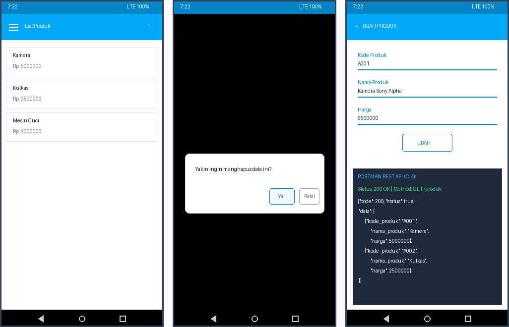

# Laporan Praktikum Pemrograman Mobile
**Nama** : Iqsan Azhar Nuryadi  
**NIM** : H1D024009  
**Shift** : Awal A / Akhir C  
**Praktikum** : Pemrograman Mobile  

---

## 📝 Tugas Pertemuan 1
**Tanggal**: Selasa, 20 Oktober 2026


### Kesimpulan Praktikum:
Pada pertemuan pertama, praktikum memberikan pemahaman dasar mengenai konsep pengembangan aplikasi mobile. Mahasiswa dapat mengenali struktur proyek, alur kerja, serta pentingnya konsistensi dalam penulisan kode agar aplikasi mudah dikembangkan dan dipelihara.

---

## 📝 Tugas Pertemuan 2
**Tanggal**: Selasa, 27 Oktober 2026


### Kesimpulan Praktikum:
Pertemuan kedua menekankan pada implementasi fitur interaktif dalam aplikasi mobile. Mahasiswa belajar bagaimana menghubungkan antarmuka dengan logika program sehingga aplikasi dapat merespons input pengguna secara dinamis dan memberikan pengalaman yang lebih baik.

---

## 📝 Tugas Pertemuan 3
**Tanggal**: Selasa, 3 November 2026


### Kesimpulan Praktikum:
Pertemuan ketiga membuka wawasan tentang pengembangan aplikasi mobile yang lebih kompleks. Mahasiswa belajar bagaimana mengintegrasikan berbagai komponen dan fitur untuk menciptakan aplikasi yang lebih lengkap dan bermanfaat.

---

## 📝 Tugas Pertemuan 4
**Tanggal**: Selasa, 10 November 2026



### Kesimpulan Praktikum:
Pada pertemuan keempat, praktikum mempelajari arsitektur RESTful API menggunakan framework CodeIgniter 4 (PHP) yang terhubung dengan basis data MySQL `toko_api` serta pembuatan aplikasi mobile Flutter TokoKita. Mahasiswa mempraktikkan perancangan basis data, implementasi endpoint autentikasi (Registrasi dan Login dengan enkripsi kata sandi dan token), serta operasi CRUD penuh (Create, Read/List, Detail, Update, Delete) pada data produk yang diuji secara menyeluruh melalui REST Client dan antarmuka mobile.

---

## 🚀 Panduan Menjalankan Proyek

### 1. Menjalankan Backend API CodeIgniter 4 (Laragon)
- Pastikan Apache dan MySQL di Laragon telah aktif.
- Direktori backend: `C:\laragon\www\toko-api`
- Database: `toko_api` (MySQL port 3306)
- Base URL API: `http://localhost/toko-api/public/`
- Daftar Endpoint:
  - `POST /registrasi` : Registrasi akun pengguna baru
  - `POST /login` : Autentikasi dan penerbitan token sesi
  - `GET /produk` : Menampilkan seluruh daftar produk
  - `POST /produk` : Menambahkan data produk baru
  - `GET /produk/{id}` : Menampilkan rincian data produk
  - `PUT /produk/{id}` : Memperbarui data produk
  - `DELETE /produk/{id}` : Menghapus data produk

### 2. Menjalankan Aplikasi Mobile Flutter (TokoKita)
- Pasang dependensi:
  ```bash
  flutter pub get
  ```
- Jalankan pada web atau emulator:
  ```bash
  flutter run -d chrome
  ```
